<!--
  Ibrahim Al-Bari — GitHub profile README
  Palette: Deep Space Blue #003049 · Molten Lava #780000 · Brick Red #C1121F
           Papaya Whip #FDF0D5 · Steel Blue #669BBC
  Custom SVG assets live in /profile. GitHub renders SVG images but does not support
  page-level CSS or arbitrary web-font loading in Markdown.
-->

 

 

  

## 01 / ABOUT

I'm **Ibrahim Al-Bari**, a full-stack web developer with around **2 years of hands-on development experience**.

I enjoy building complete products: shaping interfaces, designing backend architecture, modeling relational data, and connecting services through reliable APIs. I care about maintainable code, thoughtful UX, and understanding how the pieces of a system fit together.

- **Focus:** Full-stack web development and backend architecture
- **Currently learning:** Python and deeper programming fundamentals
- **Interested in:** Database design, API integrations, frontend engineering, and creative development
- **Approach:** Practical engineering, continuous learning, and deliberate problem-solving

> I like understanding the system behind the interface — not just making the screen work.

  

## 02 / TECHNOLOGY

**LANGUAGES**

**FRAMEWORKS & DATA**

**TOOLS & CREATIVE**

<strong>How I like to work</strong>

- **Frontend:** Component architecture, responsive interfaces, accessibility, and motion.
- **Backend:** Server-side logic, API design, integrations, and clear system boundaries.
- **Data:** Relational modeling, PostgreSQL, data integrity, and maintainable queries.
- **Engineering:** Type safety, security, performance, and readable code.
- **Creative development:** Interactive experiences, 3D, and animation with GSAP.

  

## 03 / GITHUB ANALYTICS

<strong>About these statistics</strong>

The two cards above are generated and committed to this repository by a scheduled GitHub Actions workflow. This avoids depending on the shared public GitHub Readme Stats demo instance at render time.

- Workflow: [Update profile analytics](.github/workflows/readme-stats.yml)
- Schedule: Daily, with a manual `workflow_dispatch` option.
- The cards are stored in `/profile` and served directly by GitHub.

  

## 04 / CONTRIBUTION ACTIVITY

  

## 05 / CURRENTLY

| AREA | FOCUS |
|:--|:--|
| Building | Full-stack applications |
| Learning | Python |
| Core stack | JavaScript · TypeScript · Next.js |
| Data | PostgreSQL · Supabase |
| Exploring | Backend architecture · Creative development |

